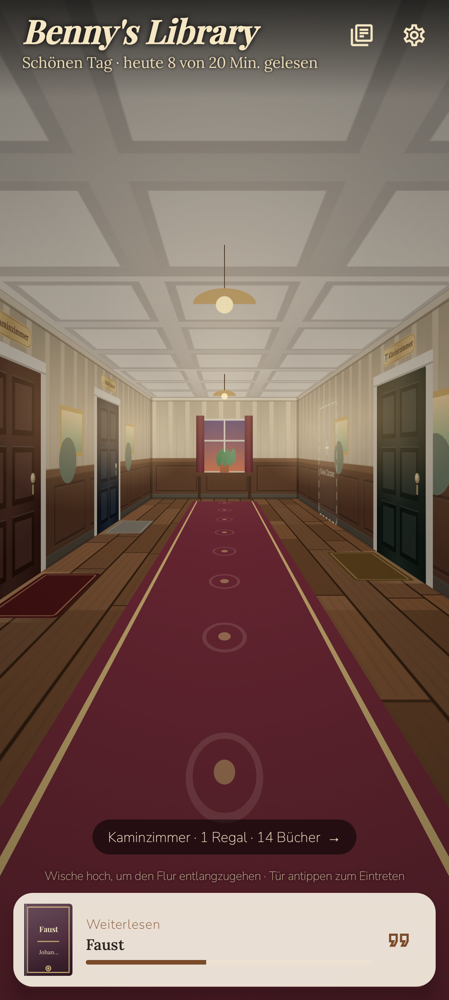
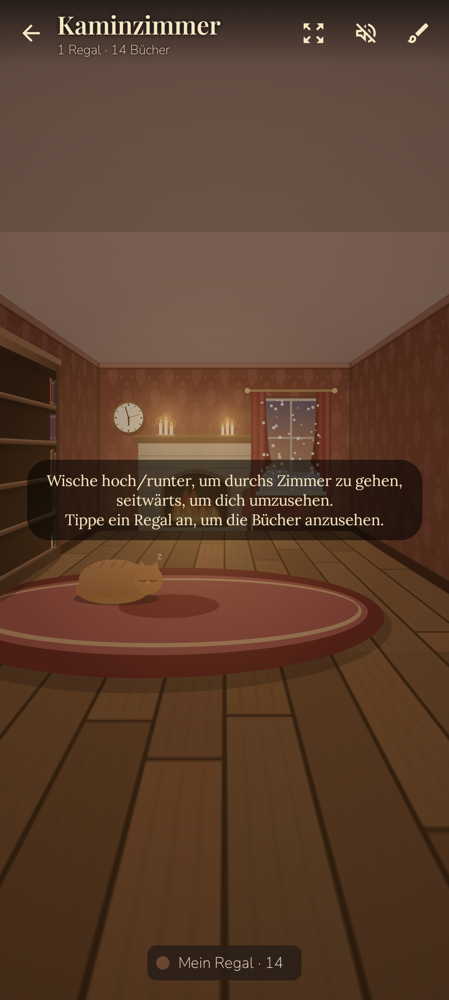
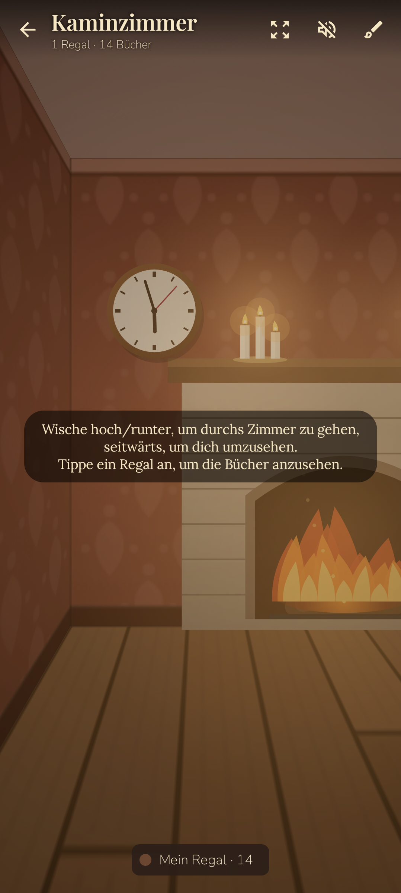
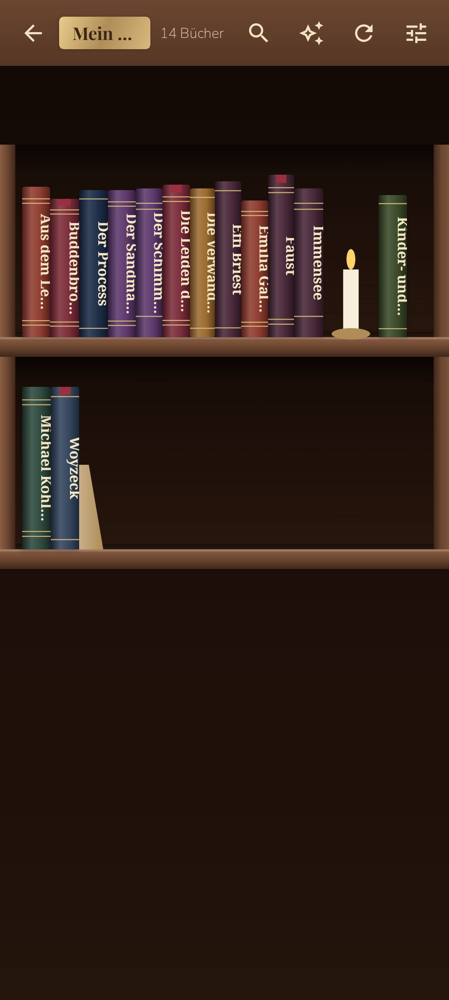
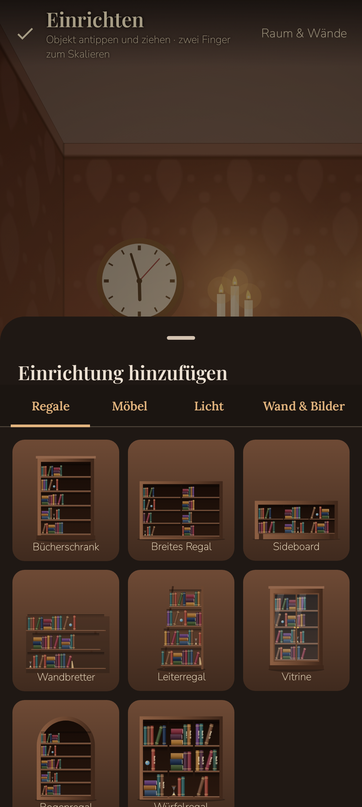
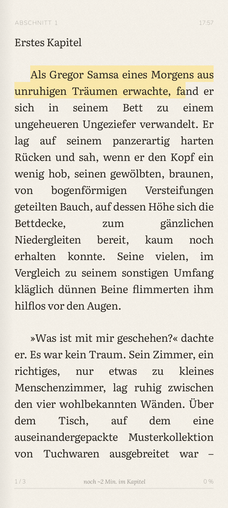
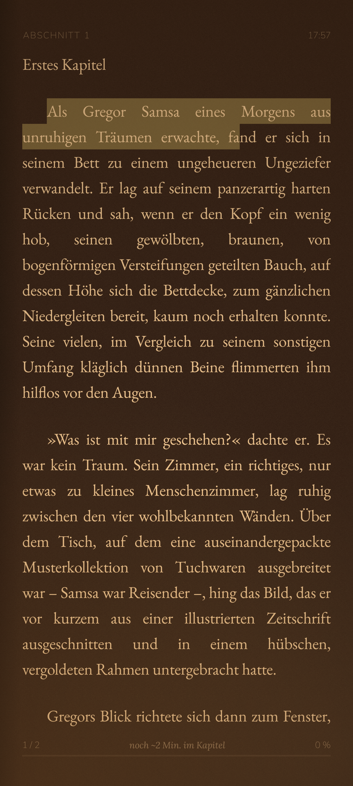
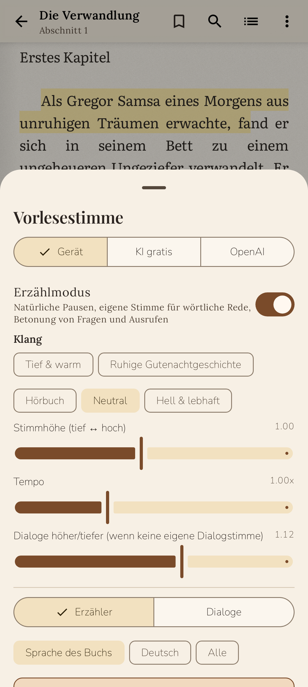

# 📚 Benny's Library – ein gemütlicher E-Book-Reader für Android

Benny's Library ist ein E-Book-Reader, in dem deine Bücher in **selbst eingerichteten Zimmern** wohnen.
Du stehst im Flur, wischst von Tür zu Tür und trittst ein: ins Kaminzimmer, Klavierzimmer, Wohnzimmer, Schlafzimmer,
die Bibliothek … In jedem Zimmer stehen echte Bücherregale mit deinen Büchern – und du richtest alles selbst ein.

| Flur (begehbar) | Zimmer (räumlich) | Hineingehen | Regal-Nahansicht |
|---|---|---|---|
|  |  |  |  |

| Einrichten | Lesen | Kaminlicht-Modus | Vorlesestimme |
|---|---|---|---|
|  |  |  |  |

## Flur & Zimmer
- **Begehbarer Flur in Perspektive**: Türen links und rechts, Kassettendecke, Pendelleuchten, Läufer, Bilder, Fenster am Ende des Gangs. Wischen = den Gang entlanggehen; Antippen = vor die Tür treten, die Tür schwingt auf, man geht hinein. 6 Türstile, Türfarbe, Namensschilder, Licht unter der Tür, Tag-/Nachtstimmung. Flur-Tapete, Boden, Decke und Läufer sind einstellbar.
- **Räumliche Zimmer (2,5D)**: echte Fluchtpunkt-Perspektive mit Rückwand, Seitenwänden, Decke und Boden. Wischen hoch/runter = vor und zurück gehen, seitwärts = zur Seite treten (mit Schwung). Raumbreite und -tiefe, Decke (glatt, Holzbalken, Kassetten), Holzvertäfelung und Bodenfarbe sind wählbar.
- Möbel, Bilder und Regale können an die **linke, rechte oder hintere Wand** oder **frei in den Raum** gestellt werden, inklusive Höhe (z. B. Tasse auf dem Tisch).
- **Einrichtungsmodus**: alles frei verschieben, mit zwei Fingern skalieren, spiegeln, nach vorn/hinten, umfärben, Varianten wählen, löschen – und aus einem Katalog mit über 30 Dingen hinzufügen: Kamin, Klavier, Sofa, Ohrensessel, Bett, Schreibtisch, Standuhr, Plattenspieler, Bibliotheksleiter, Teleskop, Globus, Stehlampe, Kronleuchter, Wandleuchte, Kerzen, Lichterkette, Fenster (auch Rundbogen), Gemälde, **eigene Fotos im Rahmen**, Spiegel, Wanduhr, Pflanzen, Hängepflanze, Blumen, Teppiche, Katze, Hund …
- **Lebendig**: Kaminfeuer, Kerzenflackern, Regen/Schnee/Gewitter am Fenster, echte Uhrzeit, Pendel, atmende Haustiere. Antippen: Licht an/aus, Wetter wechseln, Plattenspieler starten, Katze streicheln (♥).
- Wände, Tapeten, Boden, Licht, Zimmergröße und Raumklang (Kaminknistern, Regen, Wind, Meer, Uhr, Klavier – offline erzeugt).

## Regale & Bücher
- **Regale stehen wirklich im Zimmer** – 8 Bauformen: Bücherschrank, breites Regal, Sideboard, Wandbretter, Leiterregal, Vitrine mit Glastüren, Bogenregal, Würfelregal; 8 Holzarten
- **Anordnung der Bücher**: ordentlich, Regenbogen (nach Farben), gemütlich gemischt (Stapel, schräg lehnende Bücher, Deko wie Kerzen, Eulen, Sanduhr), Cover nach vorn oder Stapel
- Antippen eines Regals zoomt in die Nahansicht mit lesbaren Buchrücken
- Mehrere Regale pro Zimmer, jedes mit eigenen Ordnern (Android-Ordnerfreigabe, inkl. Unterordner) und Dateitypen
- Formate: **EPUB, PDF, TXT, Markdown, HTML, FB2, DOCX, ODT, RTF**
- Cover aus der Datei, online (Open Library / Google Books), aus der Galerie oder als generierter Stoffeinband
- Cover- oder Buchrücken-Ansicht, Holzarten, Sortierung, Lesebändchen, „Neu“- und „Gelesen“-Markierungen
- Animation beim Öffnen: Das Buch wird aus dem Regal gezogen und schlägt auf

## Lesen
- Echter Buchsatz: Blocksatz, Silbentrennung, Einzüge, Bilder, Kapitel; Blättern (Umblättern, Schieben, Stapel, Überblenden) oder Scrollen
- 9 Lese-Schriften + eigene TTF/OTF; Größe, Stärke, Zeilen-, Zeichen- & Absatzabstand, Ränder
- 8 Farbwelten (Papier, Sepia, Pergament, Salbei, Kaminlicht, Dämmerung, Mitternachtsblau, OLED-Nacht), automatischer Nachtmodus, Papierstruktur, Wärmefilter, Helligkeit
- **Gemütlicher Lesemodus** mit flackerndem Kerzenlicht und Vignette
- Lesezeichen, farbige Markierungen, Unterstreichungen, Notizen (in Handschrift-Optik)
- **Gefällt mir**: Auswahl, Satz/Zeile, Passage oder ganze Seite in Sammlungen aufbewahren und im Vollbild-Modus **wiederlesen** (auch zufällig / automatisch)
- Volltextsuche, Inhaltsverzeichnis, Restzeit im Kapitel, Uhr, Fortschritt
- **Mehrere Seiten auf einmal blättern** (±5, 10, 20, 50), Sprung zu Seitenzahl oder Prozent
- **Vorlesen** mit Wort-Hervorhebung und Schlaftimer:
  - alle installierten Gerätestimmen mit Hörprobe, Stimmhöhe (tief ↔ hoch), Tempo und Presets („Tief & warm“, „Gutenachtgeschichte“, „Hörbuch“ …)
  - **Erzählmodus**: natürliche Pausen an Sätzen/Absätzen, wörtliche Rede mit eigener Stimme oder Tonhöhe, Betonung von Fragen und Ausrufen
  - **KI-Hörbuchstimme kostenlos mit Google Gemini** (Gratis-Schlüssel aus Google AI Studio): versteht den Text, folgt Regieanweisungen (Hörbuch, gemütlich, dramatisch, geheimnisvoll …), 20 Stimmen (männlich/weiblich, tief/hell), **zwei Stimmen für Erzähler und Figuren**; ist das Tageskontingent aufgebraucht, liest die Gerätestimme nahtlos weiter
  - alternativ OpenAI-Stimmen (kostenpflichtig) oder kostenlose Offline-Stimmen über die App „SherpaTTS“
- Der Klang des Zimmers, aus dem das Buch stammt, spielt beim Lesen leise weiter
- Blättern mit Lautstärketasten, Tippzonen, Vollbild, Bildschirm anlassen
- PDF: Originalansicht mit Zoom, Sepia/Nacht-Filter, Seiten-Lesezeichen & -Notizen – oder Textmodus mit allen Reader-Funktionen

## Außerdem
- Zitate als **Bildkarte teilen** (Papier, Kaminlicht, Nachtblau)
- Lesestatistik mit Tagesziel, Lesesträhne und Diagramm
- Notizen-Übersicht mit Markdown-Export
- Sicherung & Wiederherstellung (JSON)

## Bauen
Voraussetzungen: JDK 17+, Android SDK (Plattform 35).

```bash
./gradlew :app:assembleDebug      # APK: app/build/outputs/apk/debug/app-debug.apk
./gradlew :app:testDebugUnitTest  # Parser- und Screenshot-Tests (Robolectric)
```

Jeder Push baut die APK außerdem per GitHub Actions („Android APK bauen“ → Artefakt *BennysLibrary-debug-apk*).

Technik: Kotlin, Jetpack Compose (Material 3), Room, Coil, Jsoup, PdfBox-Android. Mindestens Android 8.0.

Schriften (SIL Open Font License): Literata, EB Garamond, Lora, Crimson Pro, Atkinson Hyperlegible, Nunito, Playfair Display, Caveat.
