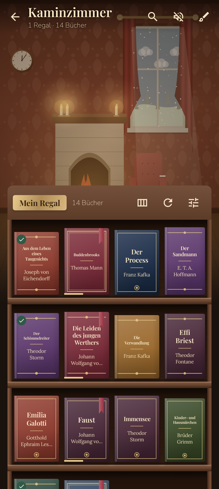
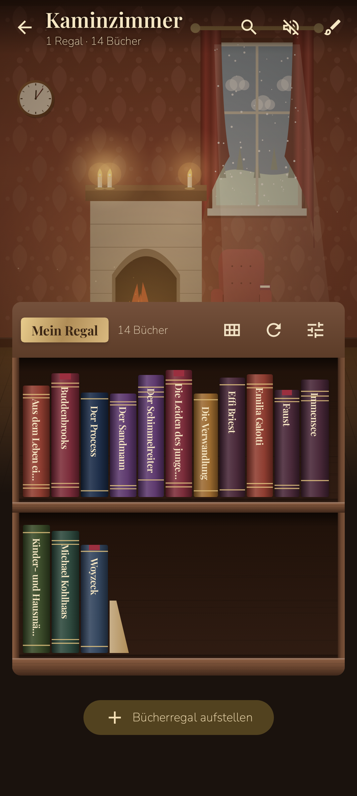
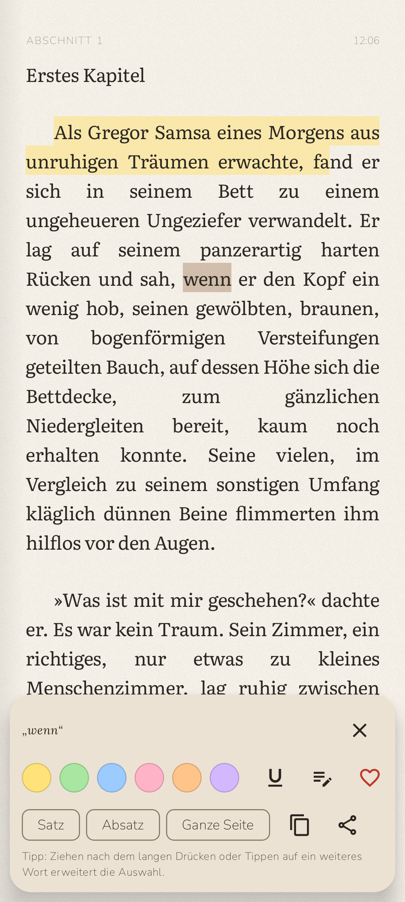
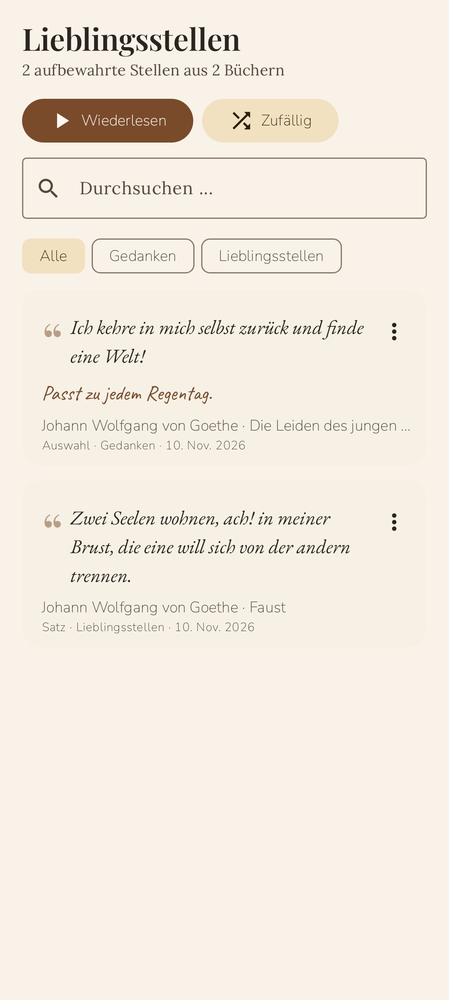
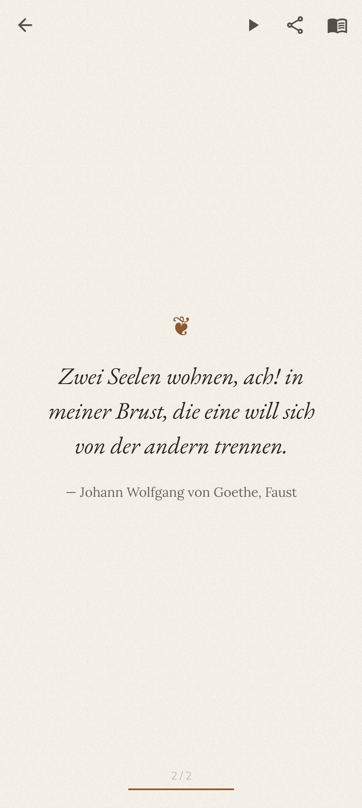

# 📚 Lesehaus – ein gemütlicher E-Book-Reader für Android

Lesehaus ist ein E-Book-Reader, in dem deine Bücher in **selbst eingerichteten Zimmern** wohnen.
Du richtest dir ein Kaminzimmer, Klavierzimmer, Wohnzimmer, Schlafzimmer, eine Bibliothek und mehr ein,
stellst Bücherregale auf, und jedes Regal sortiert die Bücher aus den Ordnern ein, die du ihm zuweist.

| Startseite | Kaminzimmer | Buchrücken | Lesen |
|---|---|---|---|
|  |  |  |  |

| Markieren | Kaminlicht-Modus | Lieblingsstellen | Wiederlesen |
|---|---|---|---|
|  |  |  |  |

## Zimmer & Ambiente
- Beliebig viele Zimmer: Kamin-, Klavier-, Wohn-, Schlaf-, Arbeitszimmer, Bibliothek, Wintergarten, Dachboden, Leseecke
- Animierte Zimmer: knisterndes Kaminfeuer, flackernde Kerzen, Regen/Schnee/Gewitter am Fenster, schlafende Katze, Teedampf, Lichterkette, Wanduhr mit echter Uhrzeit, Fensterblick passend zur Tageszeit
- Zimmer-Editor mit Live-Vorschau: Wandfarbe, Tapete (Damast, Streifen, Holz, Backstein …), Boden, Stofffarbe, Fenster & Wetter, Helligkeit & Lichtwärme, 17 Einrichtungsgegenstände, Raumklang
- Prozedural erzeugte Klangkulissen (offline): Kaminknistern, Regen, Gewitter, Wind, Meer, Uhrticken, leises Klavier

## Regale & Bücher
- Mehrere Regale pro Zimmer, jedes mit eigenen Ordnern (Android-Ordnerfreigabe, inkl. Unterordner) und Dateitypen
- Formate: **EPUB, PDF, TXT, Markdown, HTML, FB2, DOCX, ODT, RTF**
- Cover aus der Datei, online (Open Library / Google Books), aus der Galerie oder als generierter Stoffeinband
- Cover- oder Buchrücken-Ansicht, Holzarten, Sortierung, Lesebändchen, „Neu“- und „Gelesen“-Markierungen
- Animation beim Öffnen: Das Buch wird aus dem Regal gezogen und schlägt auf

## Lesen
- Echter Buchsatz: Blocksatz, Silbentrennung, Einzüge, Bilder, Kapitel; Blättern (Umblättern, Schieben, Stapel, Überblenden) oder Scrollen
- 9 Lese-Schriften + eigene TTF/OTF; Größe, Stärke, Zeilen-, Zeichen- & Absatzabstand, Ränder
- 8 Farbwelten (Papier, Sepia, Pergament, Salbei, Kaminlicht, Dämmerung, Mitternachtsblau, OLED-Nacht), automatischer Nachtmodus, Papierstruktur, Wärmefilter, Helligkeit
- **Gemütlicher Lesemodus** mit flackerndem Kerzenlicht und Vignette
- Lesezeichen, farbige Markierungen, Unterstreichungen, Notizen (in Handschrift-Optik)
- **Gefällt mir**: Auswahl, Satz/Zeile, Passage oder ganze Seite in Sammlungen aufbewahren und im Vollbild-Modus **wiederlesen** (auch zufällig / automatisch)
- Volltextsuche, Inhaltsverzeichnis, Restzeit im Kapitel, Uhr, Fortschritt
- Vorlesen (TTS) mit Wort-Hervorhebung, Tempo, Stimmhöhe und Schlaftimer
- Blättern mit Lautstärketasten, Tippzonen, Vollbild, Bildschirm anlassen
- PDF: Originalansicht mit Zoom, Sepia/Nacht-Filter, Seiten-Lesezeichen & -Notizen – oder Textmodus mit allen Reader-Funktionen

## Außerdem
- Lesestatistik mit Tagesziel, Lesesträhne und Diagramm
- Notizen-Übersicht mit Markdown-Export
- Sicherung & Wiederherstellung (JSON)

## Bauen
Voraussetzungen: JDK 17+, Android SDK (Plattform 35).

```bash
./gradlew :app:assembleDebug      # APK: app/build/outputs/apk/debug/app-debug.apk
./gradlew :app:testDebugUnitTest  # Parser- und Screenshot-Tests (Robolectric)
```

Jeder Push baut die APK außerdem per GitHub Actions („Android APK bauen“ → Artefakt *Lesehaus-debug-apk*).

Technik: Kotlin, Jetpack Compose (Material 3), Room, Coil, Jsoup, PdfBox-Android. Mindestens Android 8.0.

Schriften (SIL Open Font License): Literata, EB Garamond, Lora, Crimson Pro, Atkinson Hyperlegible, Nunito, Playfair Display, Caveat.
